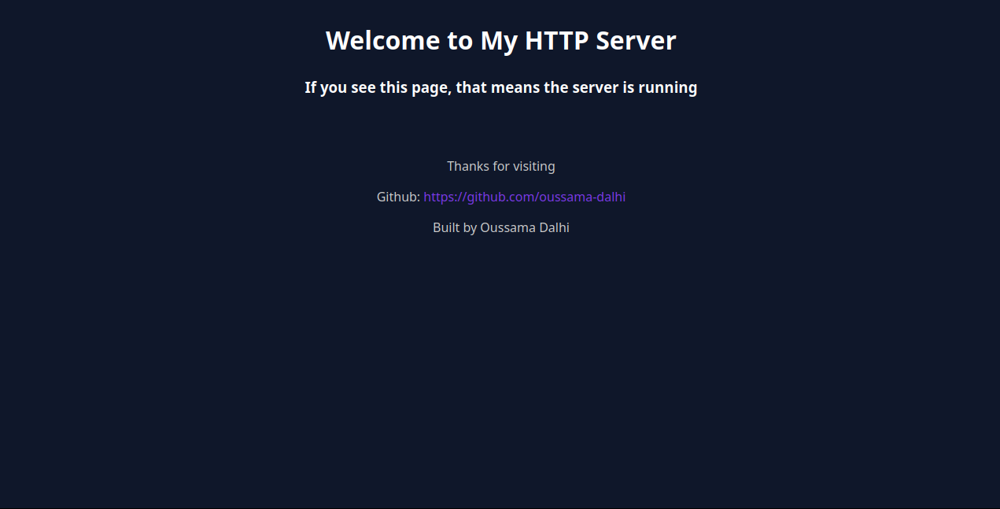

# C HTTP Server

A small static file server written from scratch in C. It uses plain sockets (POSIX on Linux/macOS, Winsock on Windows), with no external libraries.

I built it to understand how a web server works underneath: TCP connections, parsing an HTTP request, reading a file, and building a response by hand.

## Preview




## Features

- Runs on Linux, macOS and Windows from a single `src/server.c`
- Serves static files from the `public/` folder (HTML, CSS, JS, PNG, JPG, SVG)
- `/` serves `public/index.html`
- Custom 404 page (`public/404.html`)
- Correct `Content-Type` and `Content-Length` headers
- Blocks path traversal (`/../secret` returns 404)
- Rejects methods other than GET with `405`

## Build and run

Run these commands from the project root, because the server looks for `public/` in the current directory.

**Linux / macOS**

```bash
gcc -Wall -Wextra -o server src/server.c
./server
```

**Windows (MinGW)**

```bash
gcc -o server src/server.c -lws2_32
server.exe
```

Then open <http://localhost:8080> in your browser. Press `Ctrl + C` to stop the server.

## Try it with curl

```bash
curl -i localhost:8080/                                   # 200 OK, index.html
curl -i localhost:8080/style.css                          # 200 OK, text/css
curl -i localhost:8080/nope                               # 404 with the custom page
curl -i --path-as-is "localhost:8080/../src/server.c"     # 404, traversal blocked
curl -i -X POST localhost:8080/                           # 405 Method Not Allowed
```

## Project structure

```
c-http-server/
├── src/
│   └── server.c
├── public/
│   ├── index.html
│   ├── style.css
│   ├── 404.html
│   └── 404.css
├── assets/
├── README.md
└── .gitignore
```

## How it works

1. `socket()`, `bind()` and `listen()` open port 8080.
2. In a loop, `accept()` waits for a browser to connect.
3. `recv()` reads the request, and `sscanf()` pulls out the method and path.
4. The path is mapped to a file inside `public/`.
5. The file is read into memory and sent with hand-built headers using `send()`.
6. The connection is closed and the server waits for the next client.

## Limitations

- Handles one client at a time
- Only supports GET

## Author

Oussama Dalhi: [github.com/oussama-dalhi](https://github.com/oussama-dalhi)
