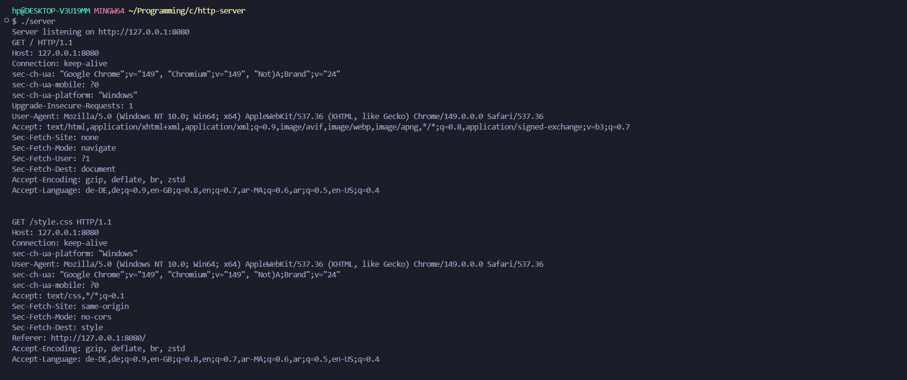
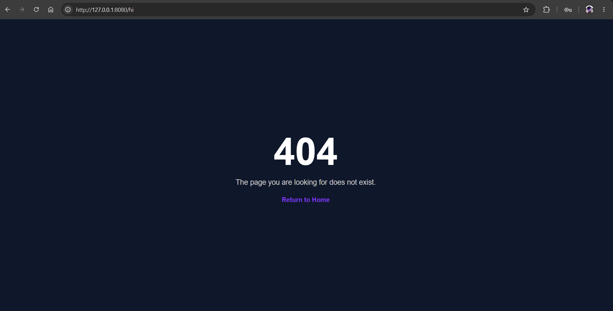
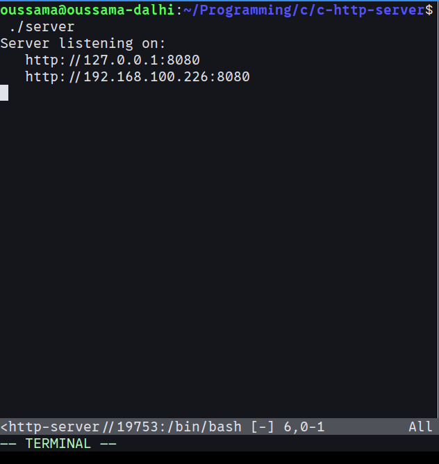
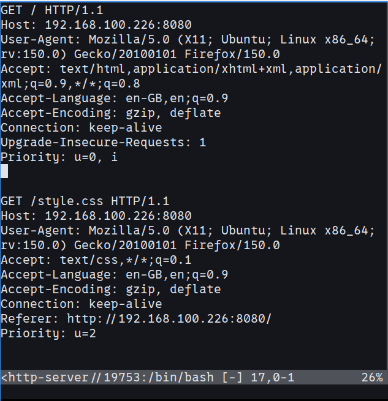
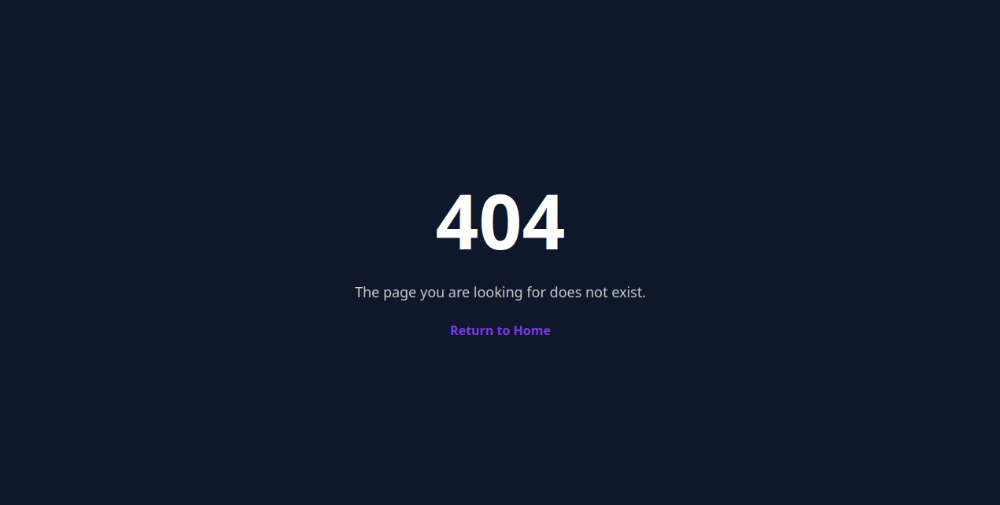
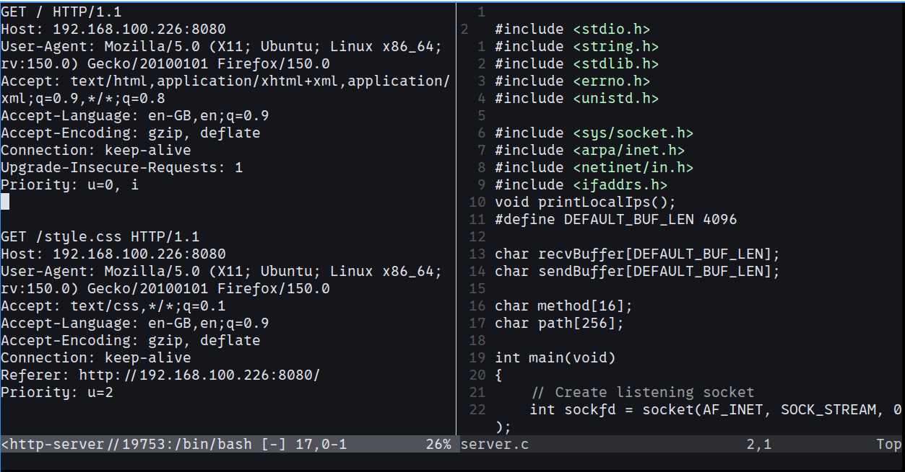

# HTTP Server in C


---

## Preview

### Homepage


### Server Running



### 404 Page



---
## Setup Guide (Windows)

### 1. Clone the Repository

```bash
git clone https://github.com/oussama-dalhi/c-http-server.git
cd c-http-server
```

---

### 2. Install GCC (MinGW)

This project requires a C compiler.

Verify GCC is installed:

```bash
gcc --version
```

If GCC is not installed, install MinGW and ensure `gcc` is available in your system PATH.

---

### 3. Compile the Server

Build the project using:

```bash
gcc server.c -o server -lws2_32
```

The `-lws2_32` flag links the Windows Sockets library required by Winsock.

After a successful build, an executable named:

```text
server.exe
```

will be created.

---

### 4. Run the Server

Start the server:

```bash
server.exe
```

Expected output:

```text
Server listening on http://127.0.0.1:8080
```

---

### 5. Open the Application

Open a web browser and navigate to:

```text
http://127.0.0.1:8080
```

The server will serve the requested files and display incoming HTTP requests in the terminal.

---

### 6. Stop the Server

Press:

```text
Ctrl + C
```

in the terminal to stop the server.

## Features

* TCP server built with Winsock
* HTTP/1.1 request handling
* GET request support
* Static file serving
=======
A simple HTTP server written from scratch in C using the Linux socket API.

This project was built to understand how web servers work internally by implementing networking, request parsing, routing, and HTTP response generation without relying on external frameworks.

The server listens for TCP connections, parses incoming HTTP requests, serves static files, and returns custom HTTP responses including a custom 404 page.

---

## Features

* TCP server built using Linux sockets
* HTTP/1.1 request handling
* Support for GET requests
* Serves static files
>>>>>>> cross-platform

  * HTML
  * CSS
  * JavaScript
<<<<<<< HEAD
* Dynamic routing based on requested path
* MIME type detection
* Custom 404 page support
* Dynamic Content-Length calculation
* Manual HTTP response generation
* Sequential client handling
* File loading using standard C file I/O
=======
* Dynamic routing based on URL paths
* Content-Type detection
* Custom 404 page support
* Sequential client handling
* Manual HTTP response generation
* Automatic local IP address discovery
* LAN access support
>>>>>>> cross-platform

---

## Technologies

* C
<<<<<<< HEAD
* Winsock2
* TCP/IP
* HTTP/1.1
* File I/O
* Dynamic Memory Allocation
=======
* Linux Socket API
* TCP/IP
* HTTP/1.1
* GCC
* Neovim

---

## Screenshots

### Server Startup

The server automatically discovers and displays available network interfaces.

This allows the application to be accessed locally and from other devices connected to the same network.



---

### HTTP Request Logging

Incoming browser requests are printed directly to the terminal.

This makes it easier to understand how browsers communicate with web servers.



---

### Homepage

The default page served by the HTTP server.


---

### Custom 404 Page

When a requested file cannot be found, the server serves a custom 404 page.



---


### Development Workflow

The project was developed on Linux using Neovim and GCC.


>>>>>>> cross-platform

---

## How It Works

<<<<<<< HEAD
When a browser connects to the server, the following sequence occurs:

```text
Browser
   │
   ▼
TCP Connection
   │
   ▼
accept()
   │
   ▼
recv()
   │
   ▼
Parse HTTP Request
   │
   ▼
Determine Requested File
   │
   ▼
Read File From Disk
   │
   ▼
Build HTTP Response
   │
   ▼
send()
   │
   ▼
Browser Renders Content
```

---

## Detailed Request Lifecycle

### 1. Initialize Winsock

Before any network communication can occur, the Windows networking subsystem must be initialized.

```c
WSAStartup(MAKEWORD(2, 2), &wsaData);
```

This loads the Winsock DLL and prepares the application for socket operations.

---

### 2. Create a Listening Socket

A TCP socket is created using:
=======
### 1. Create a Socket

The server creates a TCP socket using:
>>>>>>> cross-platform

```c
socket(AF_INET, SOCK_STREAM, 0);
```

| Parameter   | Meaning          |
| ----------- | ---------------- |
| AF_INET     | IPv4             |
| SOCK_STREAM | TCP              |
| 0           | Default protocol |

This socket will listen for incoming browser connections.

---

<<<<<<< HEAD
### 3. Configure the Server Address
=======
### 2. Configure the Server Address
>>>>>>> cross-platform

The server listens on port 8080.

```c
serverAddr.sin_family = AF_INET;
serverAddr.sin_port = htons(8080);
serverAddr.sin_addr.s_addr = INADDR_ANY;
```

Using `INADDR_ANY` allows the server to accept connections from all available network interfaces in the current network.

---

<<<<<<< HEAD
### 4. Bind the Socket
=======
### 3. Bind the Socket
>>>>>>> cross-platform

```c
bind(sockfd,
     (const struct sockaddr *)&serverAddr,
     sizeof(serverAddr));
```

<<<<<<< HEAD
Binding associates the socket with a specific IP address and port number.

Without binding, the operating system would not know where incoming requests should be delivered.

---

### 5. Start Listening
=======
With bind we associate the socket with a local address and port.

---

### 4. Start Listening
>>>>>>> cross-platform

```c
listen(sockfd, SOMAXCONN);
```

<<<<<<< HEAD
The socket is switched into listening mode.

At this point the server is waiting for browsers to connect.
=======
The operating system begins accepting incoming TCP connection requests.

---

### 5. Display Available Network Interfaces

The server uses:

```c
getifaddrs()
```

to enumerate network interfaces and print all available IPv4 addresses.

Example:

```text
Server listening on:

http://127.0.0.1:8080
http://192.168.100.226:8080
```

This allows access from:

* The local machine
* Other devices on the same network
>>>>>>> cross-platform

---

### 6. Accept Incoming Connections

<<<<<<< HEAD
The server runs continuously:
=======
The server continuously waits for new clients:
>>>>>>> cross-platform

```c
while (1)
{
    accept(...);
}
```

<<<<<<< HEAD
Each new browser connection creates a dedicated client socket.

```c
accept(...)
```

The listening socket remains active while the client socket handles communication.
=======
Each accepted connection receives its own client socket.
With each request memory gets allocated and freed
>>>>>>> cross-platform

---

### 7. Receive the HTTP Request

<<<<<<< HEAD
The browser sends a request similar to:

```http
GET / HTTP/1.1
Host: 127.0.0.1:8080
```

The server receives the request using:
=======
Incoming requests are read using:
>>>>>>> cross-platform

```c
recv(...)
```

<<<<<<< HEAD
The raw request is stored in:
=======
Example request:
>>>>>>> cross-platform

```http
GET / HTTP/1.1
Host: 192.168.100.226:8080
User-Agent: Firefox
```

<<<<<<< HEAD
For debugging purposes, the complete request is printed to the terminal.
=======
The raw request is printed to the terminal for debugging and learning purposes.
>>>>>>> cross-platform

---

### 8. Parse the Request

<<<<<<< HEAD
The request line is parsed using:

```c
sscanf(recvBuffer, "%15s %255s", method, path);
=======
The request method and path are extracted using:

```c
sscanf(recvBuffer,
       "%15s %255s",
       method,
       path);
>>>>>>> cross-platform
```

Example:

```text
Method: GET
Path: /style.css
```

This information determines which file should be returned.

---

### 9. Route Requests

The requested path is mapped to a file on disk.

Examples:

<<<<<<< HEAD
| URL        | File Served |
=======
| Request    | File Served |
>>>>>>> cross-platform
| ---------- | ----------- |
| /          | index.html  |
| /style.css | style.css   |
| /script.js | script.js   |
<<<<<<< HEAD

```c
if (strcmp(path, "/") != 0)
{
    filename = path + 1;
}
```
=======
>>>>>>> cross-platform

---

### 10. Detect Content Type

The server determines the correct MIME type.

Examples:

```text
text/html
text/css
application/javascript
```

<<<<<<< HEAD
This allows browsers to properly interpret received files.

```c
if (strstr(filename, ".css"))
{
    contentType = "text/css";
}
```
=======
This allows browsers to properly interpret files.
>>>>>>> cross-platform

---

### 11. Load the Requested File

The requested file is opened:

```c
fopen(filename, "rb");
```

<<<<<<< HEAD
The server then:

1. Determines file size
2. Allocates memory
3. Reads the entire file
4. Stores it in memory

Functions used:
=======
The file contents are loaded into memory using:
>>>>>>> cross-platform

```c
fseek(...)
ftell(...)
malloc(...)
fread(...)
```

---

<<<<<<< HEAD
### 12. Handle Missing Files

If the requested file cannot be found:

```c
fopen(...) == NULL
```

the server attempts to load:

```text
404.html
```

If no custom 404 page exists, a minimal 404 response is returned.

Example:

```http
HTTP/1.1 404 Not Found
```

---

### 13. Build the HTTP Response

The response headers are manually generated.
=======
### 12. Build the HTTP Response

Response headers are manually created using:

```c
snprintf(...)
```
>>>>>>> cross-platform

Example:

```http
HTTP/1.1 200 OK
Connection: close
Content-Type: text/html
Content-Length: 559
```

---

<<<<<<< HEAD
### 14. Send the Response

The response is sent in two stages.
=======
### 13. Send the Response

The response is transmitted in two stages.
>>>>>>> cross-platform

#### Header

```c
send(clientSocket,
     sendBuffer,
     strlen(sendBuffer),
     0);
```

#### Body

```c
send(clientSocket,
     htmlBuffer,
<<<<<<< HEAD
     (int)fileSize,
=======
     fileSize,
>>>>>>> cross-platform
     0);
```

The browser then renders the received content.

---

### 15. Close the Connection

<<<<<<< HEAD
After the response has been delivered:
=======
If a requested file cannot be found:
>>>>>>> cross-platform

```c
closesocket(clientSocket);
```

<<<<<<< HEAD
The server returns to the listening loop and waits for the next connection.
=======
the server serves a custom 404 page.

Example response:

```http
HTTP/1.1 404 Not Found
```
>>>>>>> cross-platform

---

## Example Request

```http
GET /style.css HTTP/1.1
Host: 192.168.100.226:8080
```

---

## Example Response

```http
HTTP/1.1 200 OK
Connection: close
Content-Type: text/css
Content-Length: 1372
```

---

## Project Structure

```text
c-http-server/
│
├── screenshots/
│   ├── homepage.png
│   ├── server-output.png
│   └── 404-page.png
│
├── server.c
├── index.html
├── style.css
<<<<<<< HEAD
├── script.js
├── 404.html
├── README.md
└── .gitignore
=======
├── 404.html
├── screenshots/
│   ├── homepage.png
│   ├── 404-page.png
│   ├── server-startup.png
│   ├── http-request.png
│   └── nvim-workflow.png
│
├── .gitignore
└── README.md
```

---

## Installation

### Clone the Repository

```bash
git clone https://github.com/oussama-dalhi/c-http-server.git
cd c-http-server
```

### Compile

```bash
gcc -o server server.c
```

### Run

```bash
./server
```

Expected output:

```text
Server listening on:

http://127.0.0.1:8080
http://192.168.100.226:8080
```

---

## Accessing the Server

From the same machine:

```text
http://127.0.0.1:8080
```

From another device on the same network:

```text
http://YOUR_LOCAL_IP:8080
```

Example:

```text
http://192.168.100.226:8080
>>>>>>> cross-platform
```

---

## Building

<<<<<<< HEAD
### MinGW GCC

```bash
gcc server.c -o server -lws2_32
```

---

## Running

```bash
server.exe
```

Output:

```text
Server listening on http://127.0.0.1:8080
```

Open:

```text
http://127.0.0.1:8080
```

in your browser.

---

## What I Learned

Through this project I gained practical experience with:

* TCP/IP networking
* Socket programming
* Winsock API
* HTTP request parsing
* HTTP response generation
* MIME types
* Static file serving
* Memory allocation
* File I/O
=======
Through this project I gained practical experience with:

* Linux socket programming
* TCP/IP networking
* HTTP request parsing
* HTTP response generation
* MIME types
* Client-server architecture
* Memory allocation
* File I/O
* Network interface enumeration
>>>>>>> cross-platform
* Browser-server communication
* Debugging network applications

---

## Future Improvements

Potential enhancements include:

<<<<<<< HEAD
* Linux port using POSIX sockets
* Keep-Alive connections
* Multithreading
* Serving images
* Improved HTTP parsing
* Logging system
* Better error handling
* Directory traversal protection
* HTTP status code abstraction
=======
* Multithreading
* Thread pools
* Keep-Alive connections
* Serving images
* Additional MIME types
* Better request parsing
* Directory traversal protection
* Logging system
* Configuration file support
* HTTP POST support
>>>>>>> cross-platform

---

## Author

Oussama Dalhi

GitHub: https://github.com/oussama-dalhi
